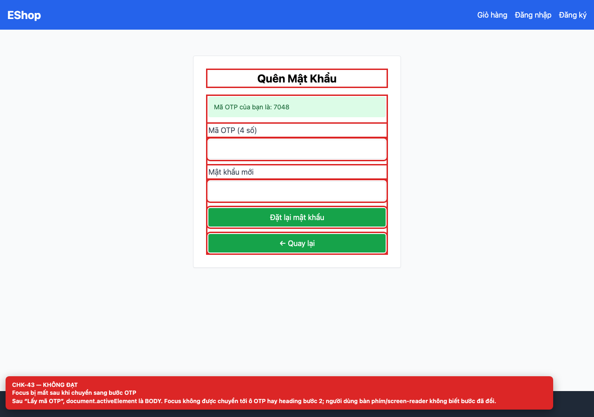

## Summary

Focus is lost after switching to the OTP step.

## Environment

- SUT: EShop (`frontend-web`)
- URL: http://localhost:5173
- Browser: Chromium 158 (Playwright 1.65)
- Viewport: 1280×900 desktop; 360×800 mobile for responsive checks
- FR: FR-03 · IA-03 · Forgot Password
- Checklist IDs: CHK-43

## Steps to reproduce

1. Request an OTP.
2. Inspect document.activeElement after step 2 renders.

## Expected

Focus moves to the OTP field or the step-2 heading and the change is announced.

## Actual

document.activeElement is BODY; screen-reader and keyboard users are not told that the step changed.

## Evidence

## Root cause

ForgotPassword.jsx:13-22 (setStep without focus management).

## Suggested fix

Focus the step-2 heading or first input in an effect and use aria-live for the status message.
