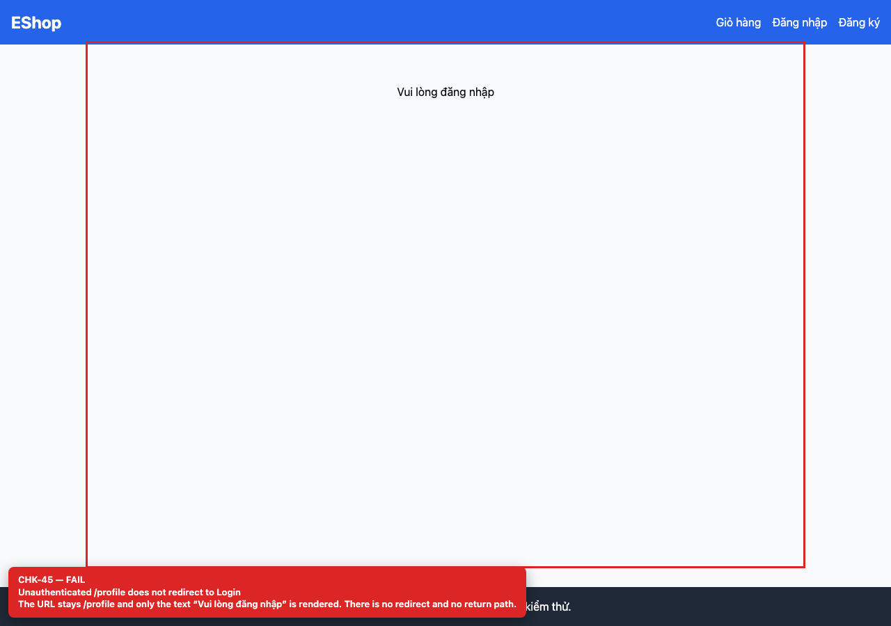
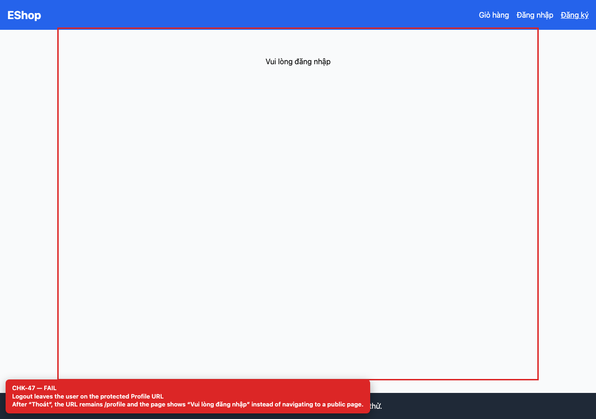
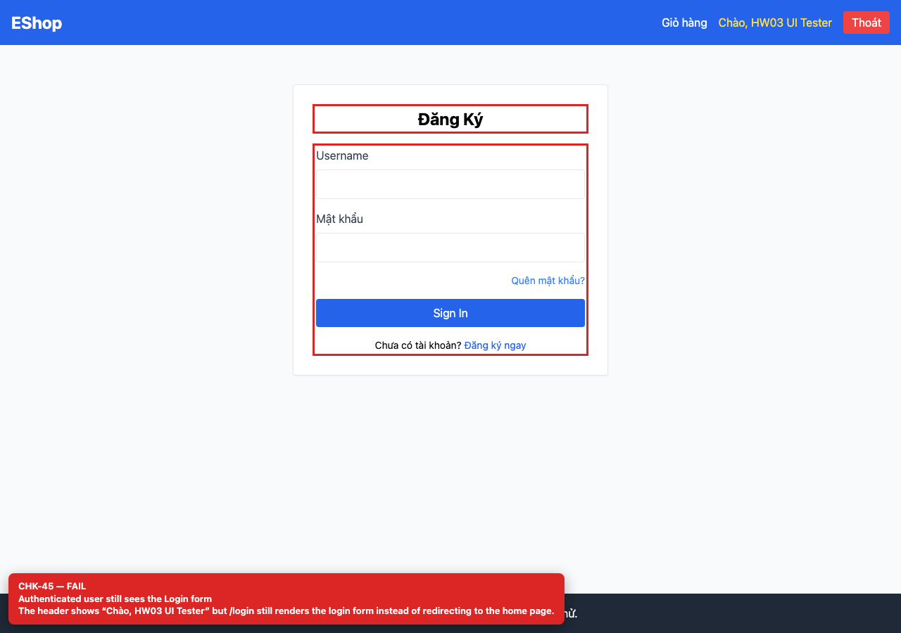

## Summary

Auth route guards are missing (profile, login, logout).

## Environment

- SUT: EShop (`frontend-web`)
- URL: http://localhost:5173
- Browser: Chromium 158 (Playwright 1.65)
- Viewport: 1280×900 desktop; 360×800 mobile for responsive checks
- FR: FR-02, FR-04 · IA-03 · Login, Profile
- Checklist IDs: CHK-45, CHK-47, CHK-69

## Steps to reproduce

1. Open /profile in a private window.
2. Log in, then open /login.
3. Log out and observe the URL.

## Expected

Unauthenticated /profile redirects to /login?next=/profile; authenticated /login redirects home; logout navigates to a public page.

## Actual

Unauthenticated /profile stays on /profile with “Vui lòng đăng nhập”; authenticated /login still renders the login form; after logout the URL remains /profile.

## Evidence

## Root cause

App.jsx:50-59 (no guards), Profile.jsx:108, AuthContext.jsx:37-41 (logout does not navigate).

## Suggested fix

Add ProtectedRoute/PublicRoute wrappers and navigate('/') or navigate('/login') on logout.
