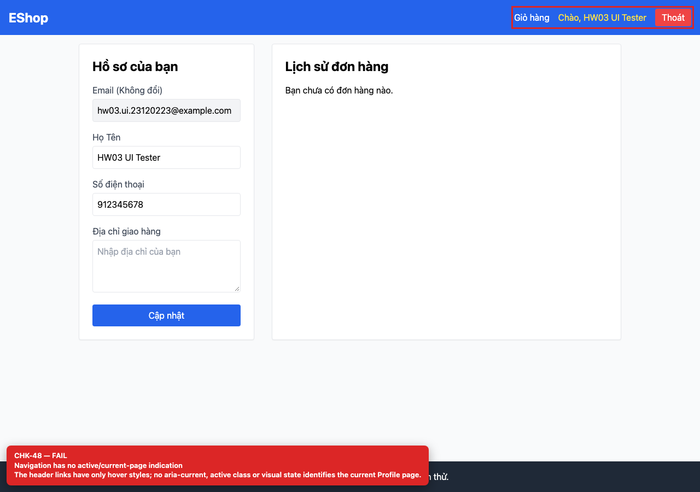

## Summary

Navigation has no current-page indication.

## Environment

- SUT: EShop (`frontend-web`)
- URL: http://localhost:5173
- Browser: Chromium 158 (Playwright 1.65)
- Viewport: 1280×900 desktop; 360×800 mobile for responsive checks
- FR: FR-04 · IA-03 · Profile
- Checklist IDs: CHK-48

## Steps to reproduce

1. Open /profile while logged in.
2. Inspect the header links for aria-current or an active class.

## Expected

The current page is visually and programmatically indicated.

## Actual

Only hover styles exist; no aria-current, active class or underline identifies /profile.

## Evidence

## Root cause

App.jsx:20-38.

## Suggested fix

Use NavLink and aria-current="page" plus an active style.
