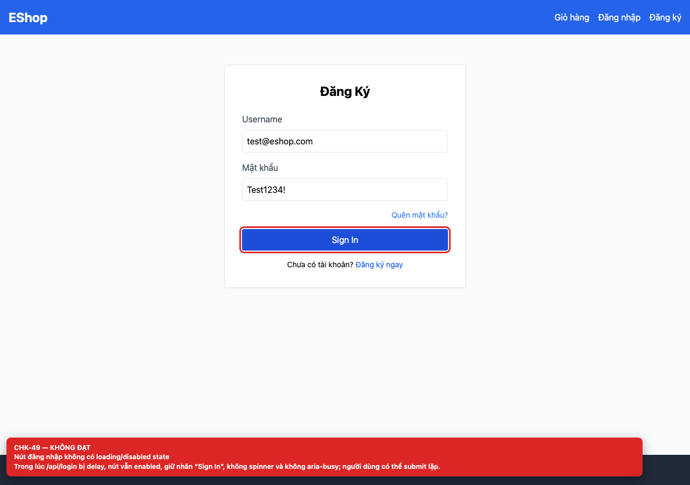
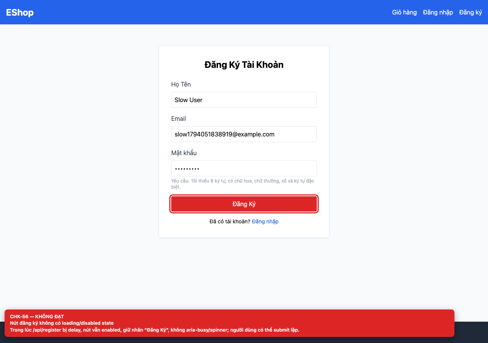

## Summary

Login and Register buttons have no loading or disabled state.

## Environment

- SUT: EShop (`frontend-web`)
- URL: http://localhost:5173
- Browser: Chromium 158 (Playwright 1.65)
- Viewport: 1280×900 desktop; 360×800 mobile for responsive checks
- FR: FR-01, FR-02 · IA-04 · Login, Register
- Checklist IDs: CHK-49, CHK-56

## Steps to reproduce

1. Delay /api/login or /api/register by 2 seconds.
2. Click the submit button and inspect it during the request.

## Expected

The button is disabled, shows a spinner/label change and exposes aria-busy.

## Actual

The button stays enabled with the same label; double submits are possible.

## Evidence

## Root cause

Login.jsx:12-20; Register.jsx:12-28.

## Suggested fix

Add a submitting state, disable the button and show a spinner or “Đang xử lý…” label.
