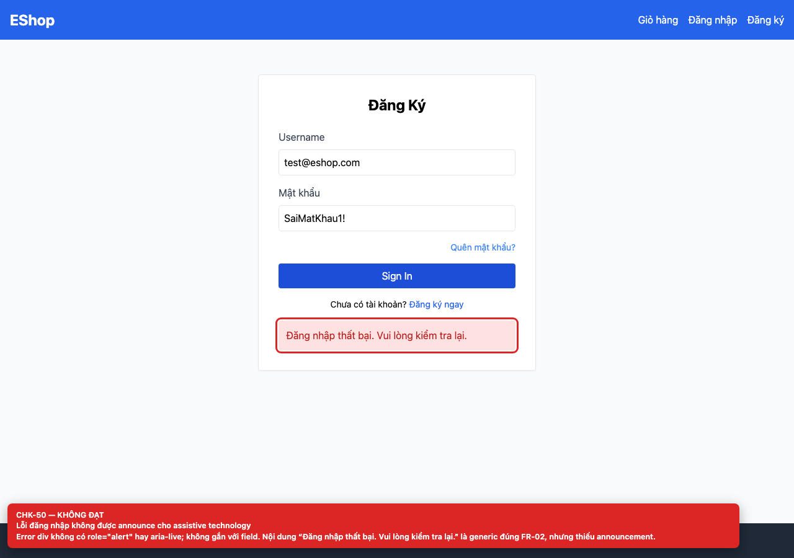
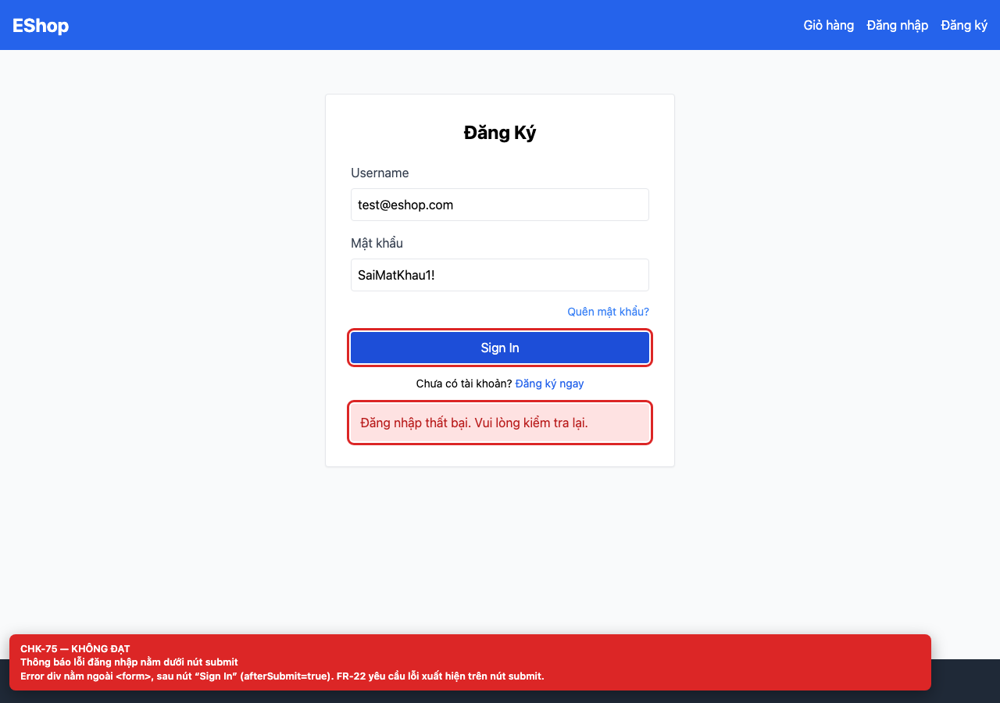

# [BUG-GUI-21] Thông báo lỗi nằm dưới nút submit hoặc dùng alert chặn

**Severity:** Major · **Priority:** High · **FR:** FR-22 — Form; FR-24 — Feedback · **Screen:** `/login, /forgot-password`

## Mô tả

Login render error div sau `</form>`, bên dưới nút “Sign In”, không có `role`/`aria-live`; Forgot Password dùng `alert("Lỗi: User not found")`, không có inline message hay field highlight.

## Các bước tái hiện

1. Nhập sai mật khẩu trên `/login` và submit.
2. Yêu cầu OTP cho email không tồn tại trên `/forgot-password`.

## Expected

Lỗi hiển thị inline, nằm trên nút submit, gắn với field và được announce qua `role="alert"`/`aria-live` (FR-22).

## Actual

Login render error div sau `</form>`, bên dưới nút “Sign In”, không có `role`/`aria-live`; Forgot Password dùng `alert("Lỗi: User not found")`, không có inline message hay field highlight.

## Checklist IDs

CHK-50, CHK-59, CHK-75

## Nguyên nhân

**[`frontend-web/src/pages/Login.jsx:61`](https://github.com/SoftwareTesting-Group13/eshop-sut-homework/blob/85af3ba875c88283615e22cb108f13e2fccaf0e9/frontend-web/src/pages/Login.jsx#L61)–[L66](https://github.com/SoftwareTesting-Group13/eshop-sut-homework/blob/85af3ba875c88283615e22cb108f13e2fccaf0e9/frontend-web/src/pages/Login.jsx#L66)**

```jsx
        <div className="text-center text-sm mt-2">
          Chưa có tài khoản? <Link to="/register" className="text-blue-600 hover:underline">Đăng ký ngay</Link>
        </div>
      </form>

      {error && <div className="bg-red-100 text-red-700 p-3 mt-4 rounded">{error}</div>}
```

Error div nằm ngoài `<form>`, sau nút submit.

**[`frontend-web/src/pages/ForgotPassword.jsx:19`](https://github.com/SoftwareTesting-Group13/eshop-sut-homework/blob/85af3ba875c88283615e22cb108f13e2fccaf0e9/frontend-web/src/pages/ForgotPassword.jsx#L19)–[L21](https://github.com/SoftwareTesting-Group13/eshop-sut-homework/blob/85af3ba875c88283615e22cb108f13e2fccaf0e9/frontend-web/src/pages/ForgotPassword.jsx#L21)**

```jsx
    } catch (err) {
      alert("Lỗi: " + (err.response?.data?.error || err.message));
    }
```

Dùng `alert()` cho lỗi request OTP.

**[`frontend-web/src/pages/ForgotPassword.jsx:36`](https://github.com/SoftwareTesting-Group13/eshop-sut-homework/blob/85af3ba875c88283615e22cb108f13e2fccaf0e9/frontend-web/src/pages/ForgotPassword.jsx#L36)–[L38](https://github.com/SoftwareTesting-Group13/eshop-sut-homework/blob/85af3ba875c88283615e22cb108f13e2fccaf0e9/frontend-web/src/pages/ForgotPassword.jsx#L38)**

```jsx
    } catch (err) {
      alert("Mã OTP không đúng hoặc có lỗi xảy ra.");
    }
```

Dùng `alert()` cho lỗi reset.

## Đề xuất sửa

Tạo inline error region phía trên nút submit, dùng `role="alert"`/`aria-live`, `aria-invalid` và `aria-describedby` trên field.

## Screenshots







> Screenshot dùng raw URL trên nhánh `ncuong`; cần push nhánh này trước khi publish issue.
