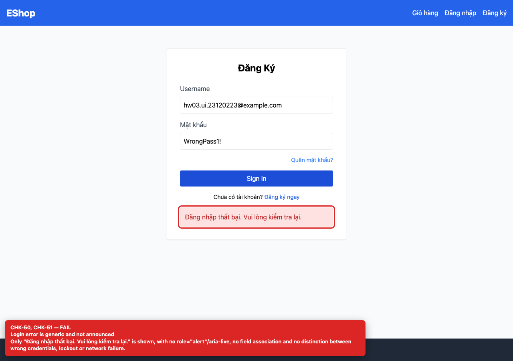
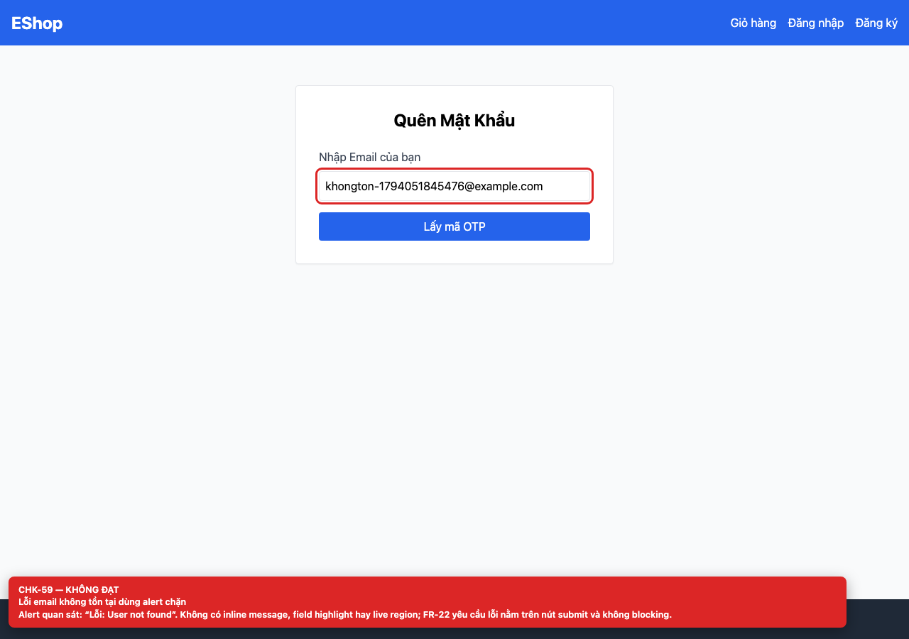
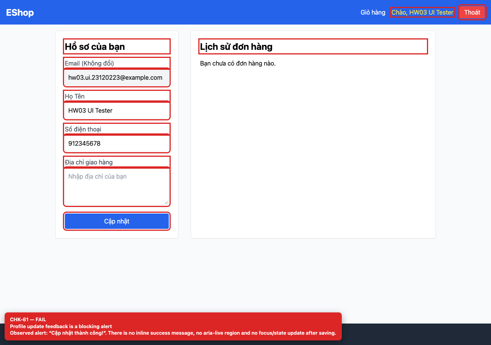

## Summary

Form feedback uses blocking alert() or unannounced divs.

## Environment

- SUT: EShop (`frontend-web`)
- URL: http://localhost:5173
- Browser: Chromium 158 (Playwright 1.65)
- Viewport: 1280×900 desktop; 360×800 mobile for responsive checks
- FR: FR-01..04 · IA-04 · Login, Forgot Password, Profile
- Checklist IDs: CHK-50, CHK-51, CHK-59, CHK-61

## Steps to reproduce

1. Submit a wrong password on /login.
2. Request an OTP for an unknown email.
3. Save the profile with an invalid phone.

## Expected

Inline, field-associated messages announced through role=alert/aria-live; no blocking dialogs.

## Actual

Login shows a generic div without role/aria-live; Forgot Password and Profile use native alert(); errors are not associated with fields and do not distinguish causes.

## Evidence

## Root cause

Login.jsx:66; ForgotPassword.jsx:20, 37; Profile.jsx:44, 60-62, 75-78.

## Suggested fix

Add an inline error/success region with role=status or role=alert, aria-describedby/aria-invalid on the field, and map server errors to specific messages.
