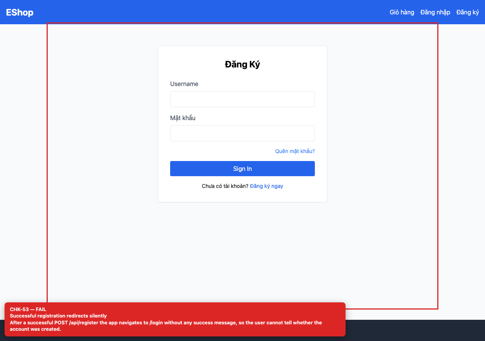

## Summary

Successful registration redirects silently.

## Environment

- SUT: EShop (`frontend-web`)
- URL: http://localhost:5173
- Browser: Chromium 158 (Playwright 1.65)
- Viewport: 1280×900 desktop; 360×800 mobile for responsive checks
- FR: FR-01 · IA-04 · Register
- Checklist IDs: CHK-53

## Steps to reproduce

1. Register a new valid account.
2. Observe the transition to /login.

## Expected

A success message confirms the account was created before the redirect.

## Actual

The app navigates to /login with no success feedback; users cannot tell whether registration succeeded.

## Evidence

## Root cause

Register.jsx:23-24.

## Suggested fix

Show a success toast/inline message and then navigate (or pass state to Login).
