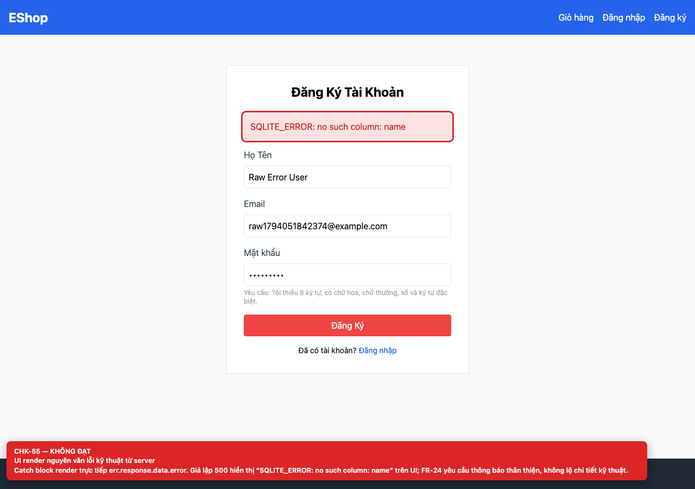

## Summary

Server error text is rendered verbatim.

## Environment

- SUT: EShop (`frontend-web`)
- URL: http://localhost:5173
- Browser: Chromium 158 (Playwright 1.65)
- Viewport: 1280×900 desktop; 360×800 mobile for responsive checks
- FR: FR-01 · IA-04 · Register
- Checklist IDs: CHK-55

## Steps to reproduce

1. Simulate POST /api/register returning 500 with a SQLite error.
2. Submit the form.

## Expected

A generic, human-readable error; technical details stay in server logs.

## Actual

The UI renders “SQLITE_ERROR: no such column: name” because the catch block uses err.response.data.error directly.

## Evidence

## Root cause

Register.jsx:26.

## Suggested fix

Map known errors to friendly messages and log the raw error server-side; never render database messages.
