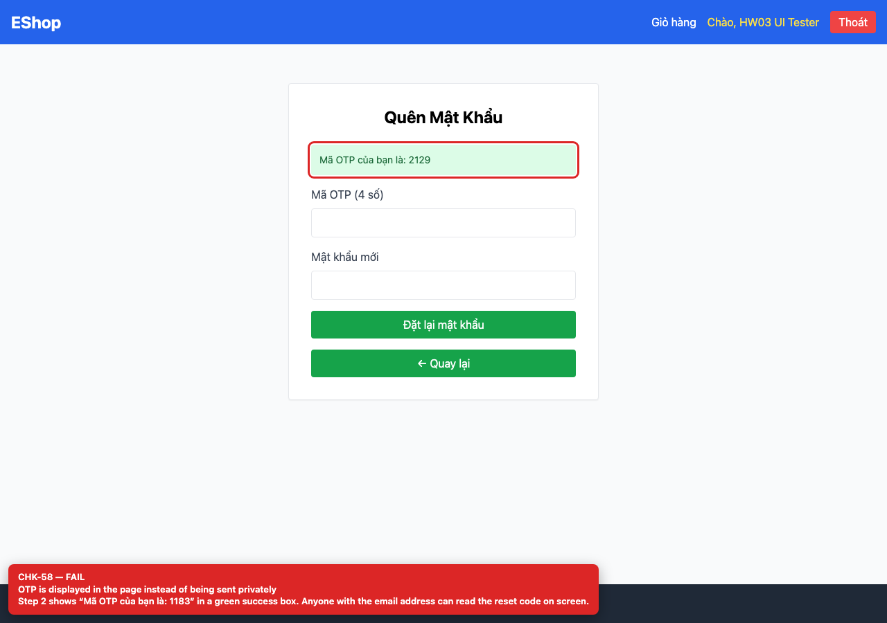

## Summary

Password-reset OTP is displayed on screen.

## Environment

- SUT: EShop (`frontend-web`)
- URL: http://localhost:5173
- Browser: Chromium 158 (Playwright 1.65)
- Viewport: 1280×900 desktop; 360×800 mobile for responsive checks
- FR: FR-03 · IA-04 · Forgot Password
- Checklist IDs: CHK-58

## Steps to reproduce

1. Open /forgot-password.
2. Enter a registered email and request the OTP.

## Expected

The OTP is sent out-of-band (email/SMS) and never shown in the UI.

## Actual

Step 2 shows “Mã OTP của bạn là: 2129” in a green box; anyone with the email address can reset the password.

## Evidence

## Root cause

ForgotPassword.jsx:16-18; backend/server.js:68-85 returns resetToken in the response.

## Suggested fix

Remove resetToken from the API response and UI; send it through a real out-of-band channel with expiry and rate limiting.
