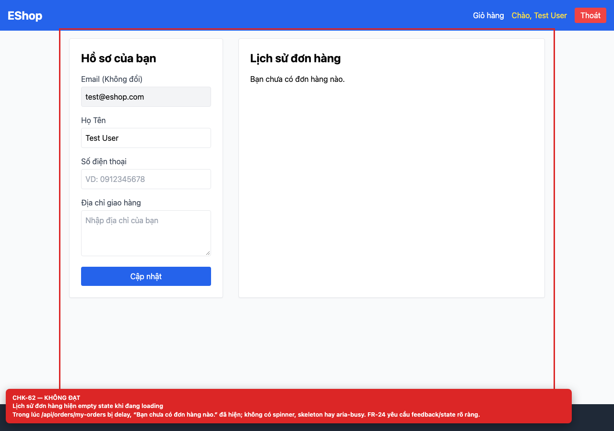
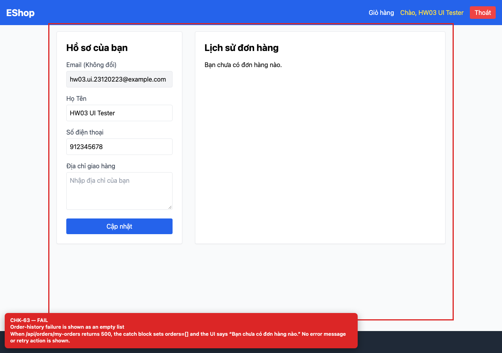

## Summary

Order-history loading and error states are shown as an empty list.

## Environment

- SUT: EShop (`frontend-web`)
- URL: http://localhost:5173
- Browser: Chromium 158 (Playwright 1.65)
- Viewport: 1280×900 desktop; 360×800 mobile for responsive checks
- FR: FR-04 · IA-04 · Profile
- Checklist IDs: CHK-62, CHK-63

## Steps to reproduce

1. Delay /api/orders/my-orders and open /profile.
2. Repeat with a 500 response.

## Expected

A loading state while fetching and a distinct error state with retry on failure.

## Actual

“Bạn chưa có đơn hàng nào.” is shown during loading and after a 500 response; users cannot tell “no orders” from “request failed”.

## Evidence

## Root cause

Profile.jsx:14-29 (catch sets []), 168-169 (single empty state).

## Suggested fix

Add loading/error state variables and render three distinct branches; add a retry button.
