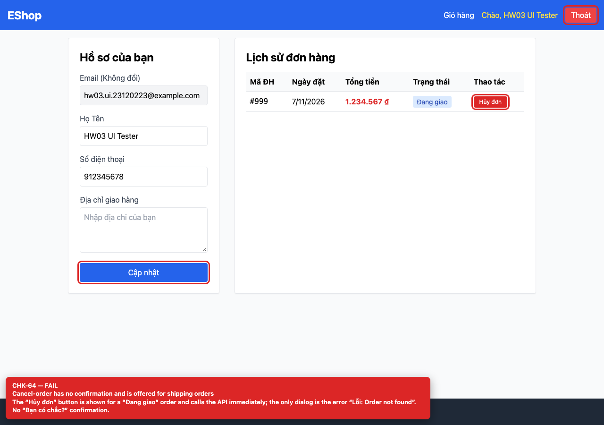

## Summary

Cancel-order has no confirmation and is offered for shipping orders.

## Environment

- SUT: EShop (`frontend-web`)
- URL: http://localhost:5173
- Browser: Chromium 158 (Playwright 1.65)
- Viewport: 1280×900 desktop; 360×800 mobile for responsive checks
- FR: FR-04 · IA-04 · Profile
- Checklist IDs: CHK-64

## Steps to reproduce

1. Open /profile with an order whose status is “Đang giao”.
2. Click “Hủy đơn”.

## Expected

A confirmation dialog before cancelling, and the action only for statuses that may be cancelled.

## Actual

The button is rendered for shipping orders and calls PUT /api/orders/:id/cancel immediately; the only dialog is the API error. No “Bạn có chắc?” confirmation.

## Evidence

## Root cause

Profile.jsx:199-207 (condition allows shipping; no confirm).

## Suggested fix

Show the button only for pending/confirmed, and require an explicit confirmation dialog before the API call.
