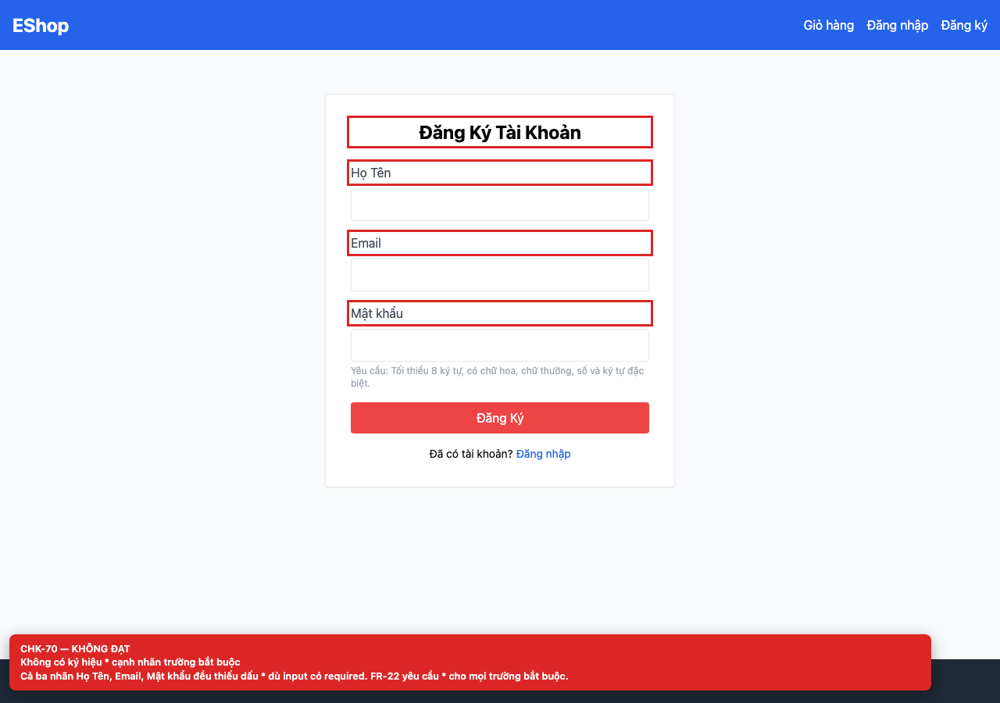

# [BUG-GUI-27] Không có ký hiệu `*` cạnh nhãn trường bắt buộc

**Severity:** Minor · **Priority:** Medium · **FR:** FR-22 — Form · **Screen:** `/login, /register, /forgot-password, /profile`

## Mô tả

Không nhãn nào có `*` dù tất cả input đều `required`.

## Các bước tái hiện

1. Mở các màn hình auth.
2. So sánh nhãn với thuộc tính `required` của từng input.

## Expected

Mọi trường bắt buộc có ký hiệu `*` bên cạnh nhãn (FR-22).

## Actual

Không nhãn nào có `*` dù tất cả input đều `required`.

## Checklist IDs

CHK-70

## Nguyên nhân

**[`frontend-web/src/pages/Register.jsx:36`](https://github.com/SoftwareTesting-Group13/eshop-sut-homework/blob/85af3ba875c88283615e22cb108f13e2fccaf0e9/frontend-web/src/pages/Register.jsx#L36)–[L56](https://github.com/SoftwareTesting-Group13/eshop-sut-homework/blob/85af3ba875c88283615e22cb108f13e2fccaf0e9/frontend-web/src/pages/Register.jsx#L56)**

```jsx
          <label className="block text-gray-700 mb-2">Họ Tên</label>
          <input
            type="text"
            value={name}
            onChange={(e) => setName(e.target.value)}
            className="w-full border p-2 rounded"
            required
          />
        </div>
        <div>
          <label className="block text-gray-700 mb-2">Email</label>
          <input
            type="text"
            value={email}
            onChange={(e) => setEmail(e.target.value)}
            className="w-full border p-2 rounded"
            required
          />
        </div>
        <div>
          <label className="block text-gray-700 mb-2">Mật khẩu</label>
```

Label “Họ Tên”, “Email”, “Mật khẩu” không có `*`; input đều `required`.

**[`frontend-web/src/pages/Login.jsx:28`](https://github.com/SoftwareTesting-Group13/eshop-sut-homework/blob/85af3ba875c88283615e22cb108f13e2fccaf0e9/frontend-web/src/pages/Login.jsx#L28)–[L38](https://github.com/SoftwareTesting-Group13/eshop-sut-homework/blob/85af3ba875c88283615e22cb108f13e2fccaf0e9/frontend-web/src/pages/Login.jsx#L38)**

```jsx
          <label className="block text-gray-700 mb-2">Username</label>
          <input
            type="text"
            value={email}
            onChange={(e) => setEmail(e.target.value)}
            className="w-full border p-2 rounded"
            required
          />
        </div>
        <div>
          <label className="block text-gray-700 mb-2">Mật khẩu</label>
```

Label “Username”, “Mật khẩu” không có `*`.

## Đề xuất sửa

Thêm `*` (kèm text ẩn “bắt buộc” cho screen-reader) vào mọi label của trường required.

## Screenshots




> Screenshot dùng raw URL trên nhánh `ncuong`; cần push nhánh này trước khi publish issue.
