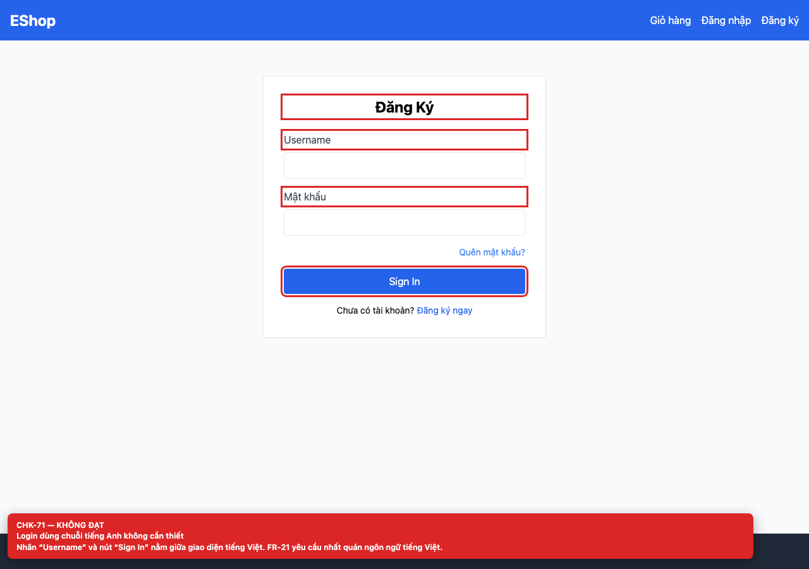

# [BUG-GUI-28] Login dùng “Username” và “Sign In” giữa giao diện tiếng Việt

**Severity:** Minor · **Priority:** Medium · **FR:** FR-21 — Tiêu chuẩn giao diện chung · **Screen:** `/login`

## Mô tả

Nhãn “Username” và nút “Sign In” là tiếng Anh không cần thiết; các màn hình khác dùng tiếng Việt.

## Các bước tái hiện

1. Mở `/login`.
2. Đọc nhãn trường và nút submit; so sánh với các màn hình còn lại.

## Expected

Toàn bộ giao diện dùng tiếng Việt, trừ thuật ngữ kỹ thuật chuẩn (FR-21).

## Actual

Nhãn “Username” và nút “Sign In” là tiếng Anh không cần thiết; các màn hình khác dùng tiếng Việt.

## Checklist IDs

CHK-71

## Nguyên nhân

**[`frontend-web/src/pages/Login.jsx:28`](https://github.com/SoftwareTesting-Group13/eshop-sut-homework/blob/85af3ba875c88283615e22cb108f13e2fccaf0e9/frontend-web/src/pages/Login.jsx#L28)**

```jsx
          <label className="block text-gray-700 mb-2">Username</label>
```

Label “Username”.

**[`frontend-web/src/pages/Login.jsx:58`](https://github.com/SoftwareTesting-Group13/eshop-sut-homework/blob/85af3ba875c88283615e22cb108f13e2fccaf0e9/frontend-web/src/pages/Login.jsx#L58)**

```jsx
          Sign In
```

Nút “Sign In”.

## Đề xuất sửa

Đổi thành “Email” và “Đăng nhập”.

## Screenshots




> Screenshot dùng raw URL trên nhánh `ncuong`; cần push nhánh này trước khi publish issue.
