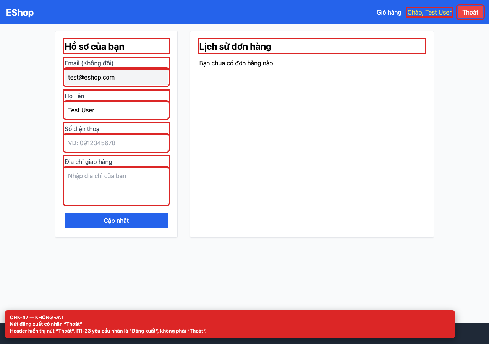

# [BUG-GUI-29] Nút đăng xuất có nhãn “Thoát” thay vì “Đăng xuất”

**Severity:** Minor · **Priority:** Medium · **FR:** FR-23 — Navigation · **Screen:** `/profile`

## Mô tả

Nhãn là “Thoát”.

## Các bước tái hiện

1. Đăng nhập và quan sát header.
2. Đọc nhãn nút đăng xuất.

## Expected

Nhãn là “Đăng xuất” (FR-23).

## Actual

Nhãn là “Thoát”.

## Checklist IDs

CHK-47

## Nguyên nhân

**[`frontend-web/src/App.jsx:29`](https://github.com/SoftwareTesting-Group13/eshop-sut-homework/blob/85af3ba875c88283615e22cb108f13e2fccaf0e9/frontend-web/src/App.jsx#L29)**

```jsx
            <button onClick={logout} className="bg-red-500 px-3 py-1 rounded">Thoát</button>
```

Button logout hard-code “Thoát”.

## Đề xuất sửa

Đổi nhãn thành “Đăng xuất”.

## Screenshots




> Screenshot dùng raw URL trên nhánh `ncuong`; cần push nhánh này trước khi publish issue.
