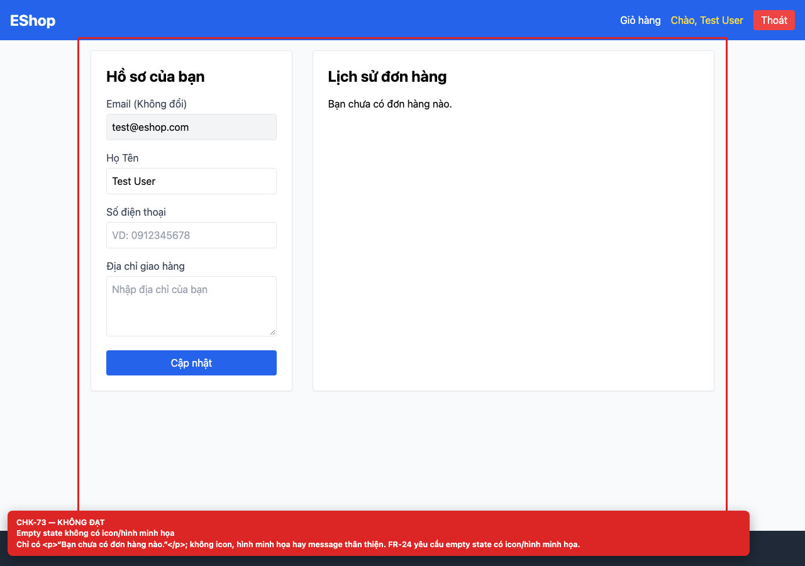

# [BUG-GUI-30] Empty state lịch sử đơn hàng không có icon/hình minh họa

**Severity:** Minor · **Priority:** Low · **FR:** FR-24 — Feedback & State · **Screen:** `/profile`

## Mô tả

Chỉ có `<p>Bạn chưa có đơn hàng nào.</p>`; không icon, hình minh họa hay hướng dẫn tiếp theo.

## Các bước tái hiện

1. Đăng nhập bằng tài khoản chưa có đơn hàng.
2. Mở `/profile` và quan sát section “Lịch sử đơn hàng”.

## Expected

Empty state có icon/hình minh họa và message thân thiện (FR-24).

## Actual

Chỉ có `<p>Bạn chưa có đơn hàng nào.</p>`; không icon, hình minh họa hay hướng dẫn tiếp theo.

## Checklist IDs

CHK-73

## Nguyên nhân

**[`frontend-web/src/pages/Profile.jsx:168`](https://github.com/SoftwareTesting-Group13/eshop-sut-homework/blob/85af3ba875c88283615e22cb108f13e2fccaf0e9/frontend-web/src/pages/Profile.jsx#L168)–[L169](https://github.com/SoftwareTesting-Group13/eshop-sut-homework/blob/85af3ba875c88283615e22cb108f13e2fccaf0e9/frontend-web/src/pages/Profile.jsx#L169)**

```jsx
        {orders.length === 0 ? (
          <p>Bạn chưa có đơn hàng nào.</p>
```

Nhánh empty state chỉ render một đoạn text.

## Đề xuất sửa

Thêm icon/illustration và message thân thiện, ví dụ “Bạn chưa có đơn hàng nào. Hãy bắt đầu mua sắm!”.

## Screenshots




> Screenshot dùng raw URL trên nhánh `ncuong`; cần push nhánh này trước khi publish issue.
