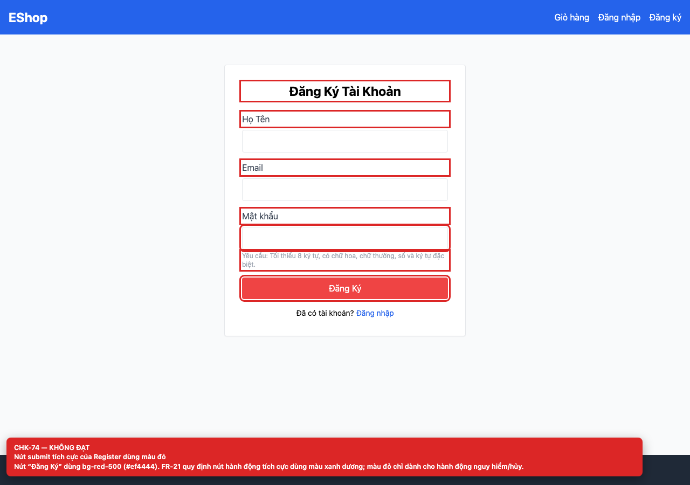
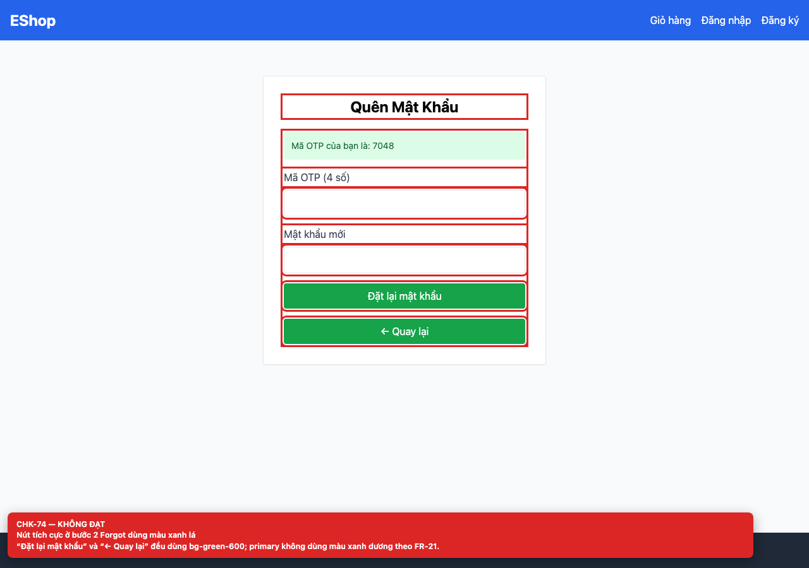

# [BUG-GUI-31] Nút hành động tích cực dùng màu đỏ/xanh lá thay vì xanh dương

**Severity:** Minor · **Priority:** Medium · **FR:** FR-21 — Tiêu chuẩn giao diện chung · **Screen:** `/register, /forgot-password`

## Mô tả

Register dùng `bg-red-500` (#ef4444); bước 2 Forgot dùng `bg-green-600` cho cả “Đặt lại mật khẩu” và “← Quay lại”; Login, Forgot bước 1 và Profile dùng xanh dương.

## Các bước tái hiện

1. Mở `/register` và quan sát nút “Đăng Ký”.
2. Lấy OTP trên `/forgot-password` và quan sát hai nút ở bước 2.

## Expected

Nút hành động tích cực dùng màu xanh dương (FR-21).

## Actual

Register dùng `bg-red-500` (#ef4444); bước 2 Forgot dùng `bg-green-600` cho cả “Đặt lại mật khẩu” và “← Quay lại”; Login, Forgot bước 1 và Profile dùng xanh dương.

## Checklist IDs

CHK-74

## Nguyên nhân

**[`frontend-web/src/pages/Register.jsx:70`](https://github.com/SoftwareTesting-Group13/eshop-sut-homework/blob/85af3ba875c88283615e22cb108f13e2fccaf0e9/frontend-web/src/pages/Register.jsx#L70)–[L75](https://github.com/SoftwareTesting-Group13/eshop-sut-homework/blob/85af3ba875c88283615e22cb108f13e2fccaf0e9/frontend-web/src/pages/Register.jsx#L75)**

```jsx
        <button
          type="submit"
          className="w-full bg-red-500 text-white py-2 rounded hover:bg-red-600"
        >
          Đăng Ký
        </button>
```

Nút submit dùng `bg-red-500`.

**[`frontend-web/src/pages/ForgotPassword.jsx:90`](https://github.com/SoftwareTesting-Group13/eshop-sut-homework/blob/85af3ba875c88283615e22cb108f13e2fccaf0e9/frontend-web/src/pages/ForgotPassword.jsx#L90)–[L95](https://github.com/SoftwareTesting-Group13/eshop-sut-homework/blob/85af3ba875c88283615e22cb108f13e2fccaf0e9/frontend-web/src/pages/ForgotPassword.jsx#L95)**

```jsx
          <button type="submit" className="w-full bg-green-600 text-white py-2 rounded">
            Đặt lại mật khẩu
          </button>
          <button type="button" onClick={() => setStep(1)} className="w-full bg-green-600 text-white py-2 rounded">
            ← Quay lại
          </button>
```

Hai nút dùng `bg-green-600`.

## Đề xuất sửa

Đổi primary action sang `bg-blue-600`; dùng đỏ chỉ cho hành động nguy hiểm/hủy.

## Screenshots






> Screenshot dùng raw URL trên nhánh `ncuong`; cần push nhánh này trước khi publish issue.
