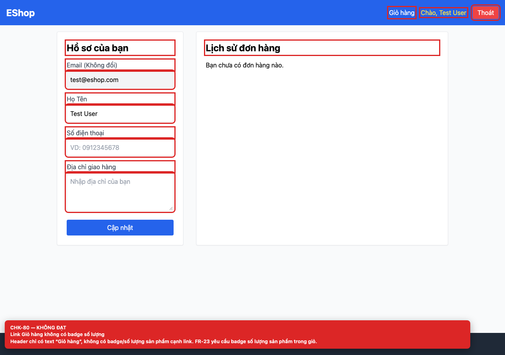

# [BUG-GUI-32] Link “Giỏ hàng” trên header không có badge số lượng

**Severity:** Minor · **Priority:** Medium · **FR:** FR-23 — Navigation · **Screen:** `/login, /register, /forgot-password, /profile`

## Mô tả

Header chỉ có text “Giỏ hàng”; không có badge hay số lượng cạnh link.

## Các bước tái hiện

1. Mở bất kỳ màn hình auth nào.
2. Quan sát link “Giỏ hàng” trên header.

## Expected

Link “Giỏ hàng” hiển thị badge số lượng sản phẩm (FR-23).

## Actual

Header chỉ có text “Giỏ hàng”; không có badge hay số lượng cạnh link.

## Checklist IDs

CHK-80

## Nguyên nhân

**[`frontend-web/src/App.jsx:22`](https://github.com/SoftwareTesting-Group13/eshop-sut-homework/blob/85af3ba875c88283615e22cb108f13e2fccaf0e9/frontend-web/src/App.jsx#L22)–[L23](https://github.com/SoftwareTesting-Group13/eshop-sut-homework/blob/85af3ba875c88283615e22cb108f13e2fccaf0e9/frontend-web/src/App.jsx#L23)**

```jsx
      <nav className="flex gap-4 items-center">
        <Link to="/cart" className="hover:underline">Giỏ hàng</Link>
```

Link cart chỉ render text, không dùng `cart.length` để hiển thị badge.

## Đề xuất sửa

Đọc `cart` từ `useCart()` và render badge số lượng cạnh link “Giỏ hàng”.

## Screenshots




> Screenshot dùng raw URL trên nhánh `ncuong`; cần push nhánh này trước khi publish issue.
