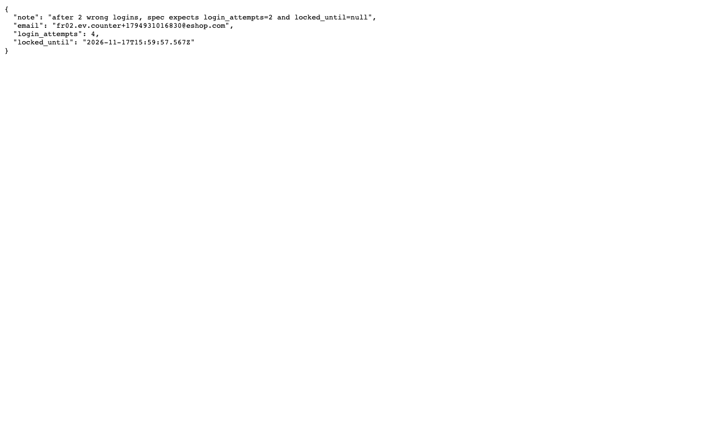

# BUG-FR02-01 — Sai mật khẩu tăng `login_attempts` lên 2 thay vì 1, khóa sớm từ lần sai thứ 2

- **Feature:** FR-02 Login and account lockout · **Pool:** A
- **Test case:** A-FR02-03, A-FR02-09 (`data/fr02-login.json`, `tests/fr02-login.spec.ts`)
- **Severity:** Major · **Browser:** Chromium, Firefox, WebKit (cả 3 đều fail giống hệt)
- **Spec:** README FR-02 — "Sau mỗi lần đăng nhập sai, hệ thống tăng bộ đếm lên **đúng 1 đơn vị**"; khóa khi sai từ 3 lần trở lên.
- **Precondition:** user mới `fr02.autoXX@eshop.com` / `Passw0rd!`, `login_attempts=0`.
- **Steps:** đăng nhập sai 1 lần (`WrongPass1!`) → đọc `GET /api/admin/users`; đăng nhập sai lần 2 → đọc lại.
- **Expected:** sau lần 1: `login_attempts=1`, chưa khóa; sau lần 2: `=2`, `locked_until=NULL`.
- **Actual:** sau lần 1: `=2`; sau lần 2: `=4` và đã bị khóa (`locked_until` tương lai). Tài khoản bị khóa chỉ sau 2 lần sai thay vì 3.
- **Root cause:** `backend/server.js:54` — `const newAttempts = user.login_attempts + 2;` (phải là `+ 1`).
- **Evidence:** `screenshots/bug-fr02-counter.png` (sau 2 lần sai: attempts=4, đã khóa)
  
- **Playwright report:** `reports/html/fr02-{chromium,firefox,webkit}/` — A-FR02-03, A-FR02-09 FAIL.
- **GitHub Issue:** <điền sau khi chạy `issues/publish.sh`>
