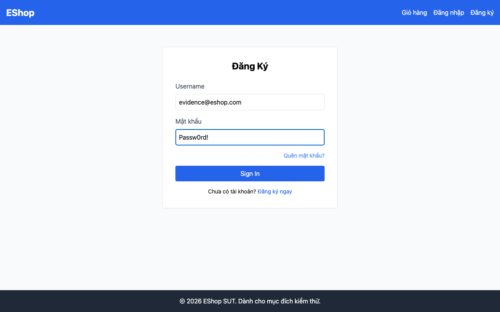

# BUG-FR02-02 — Ô email và mật khẩu dùng `type="text"`, không có validate HTML5 và lộ mật khẩu

- **Feature:** FR-02 Login and account lockout · **Pool:** A
- **Test case:** A-FR02-05, A-FR02-14 (`data/fr02-login.json`, `tests/fr02-login.spec.ts`)
- **Severity:** Major · **Browser:** Chromium, Firefox, WebKit (cả 3 đều fail giống hệt)
- **Spec:** README FR-02 — "Trường email phải dùng `type="email"`"; FR-22 — trường mật khẩu dùng `type="password"`.
- **Precondition:** mở `http://localhost:5173/login` chưa đăng nhập.
- **Steps:** nhập `not-an-email` / `Passw0rd!` → bấm Sign In; đọc attribute `type` của 2 ô input.
- **Expected:** email `type="email"` + browser chặn submit (0 request `/api/login`); mật khẩu `type="password"`.
- **Actual:** cả hai đều `type="text"` — form gửi request bình thường, mật khẩu hiện rõ trên màn hình (xem screenshot: ô mật khẩu đọc được `Passw0rd!`).
- **Root cause:** `frontend-web/src/pages/Login.jsx:30` (`type="text"` cho email), `:40` (`type="text"` cho mật khẩu).
- **Evidence:** `screenshots/bug-fr02-input-types.png`
  
- **Playwright report:** `reports/html/fr02-{chromium,firefox,webkit}/` — A-FR02-05, A-FR02-14 FAIL.
- **GitHub Issue:** https://github.com/SoftwareTesting-Group13/eshop-sut-homework/issues/129
