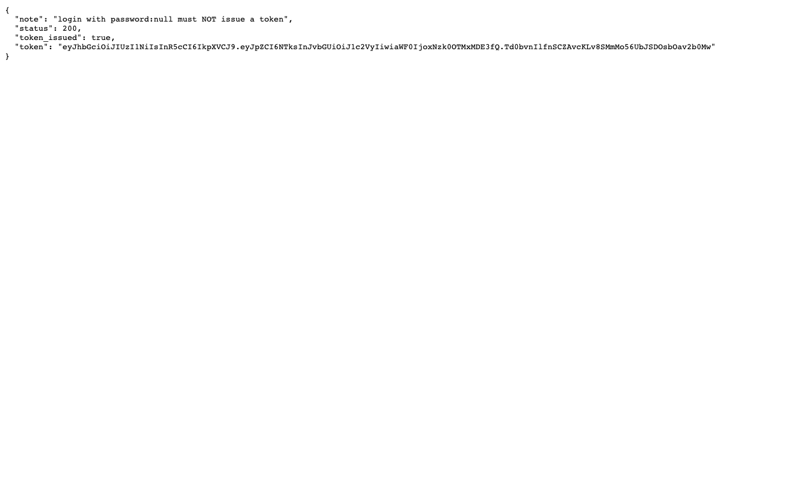

# BUG-FR02-03 (Blocker) — Đăng nhập với `password: null` được cấp JWT (null === null bypass)

- **Feature:** FR-02 Login and account lockout · **Pool:** A
- **Test case:** A-FR02-16 (`data/fr02-login.json`, `tests/fr02-login.spec.ts`)
- **Severity:** Blocker (bypass xác thực) · **Browser:** Chromium, Firefox, WebKit (cả 3 đều fail giống hệt)
- **Spec:** README FR-02 — đăng nhập sai phải bị từ chối, không cấp token; SEC-01/SEC-05 (không lưu plaintext, parameterized query không liên quan trực tiếp nhưng so sánh xác thực phải an toàn).
- **Precondition:** tài khoản có `password` NULL trong DB (tạo qua `POST /api/register` với `"password": null` — API nhận và lưu NULL, cũng là một phần của bug).
- **Steps:** `POST /api/login` body `{"email":"<user>","password":null}`.
- **Expected:** 401, không có `token` trong response.
- **Actual:** 200 + `token` JWT hợp lệ — bất kỳ ai biết email của tài khoản NULL-password đều đăng nhập được mà không cần mật khẩu.
- **Root cause:** `backend/server.js:46` — `if (user.password === password)` với cả hai vế đều `null` cho kết quả `true`. Cần từ chối khi `password` gửi lên là null/không phải chuỗi, và `POST /api/register` không được lưu NULL.
- **Evidence:** `screenshots/bug-fr02-null-bypass.png` (status 200, `token_issued: true`)
  
- **Playwright report:** `reports/html/fr02-{chromium,firefox,webkit}/` — A-FR02-16 FAIL.
- **GitHub Issue:** <điền sau khi chạy `issues/publish.sh`>
