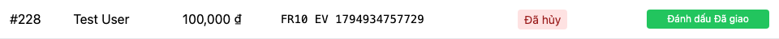
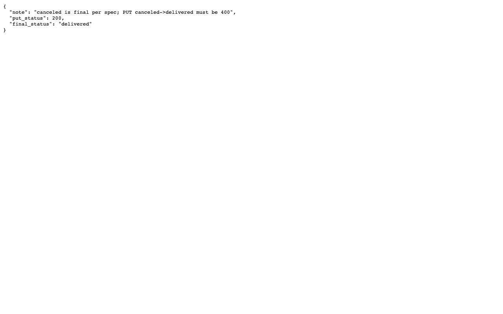

# BUG-FR10-01 — Chuyển `canceled → delivered` được cho phép (trạng thái kết thúc bị phá vỡ)

- **Feature:** FR-10 Order state machine · **Pool:** B
- **Test case:** A-FR10-08 (`data/fr10-orders.json`, `tests/fr10-orders.spec.ts`)
- **Severity:** Major · **Browser:** Chromium, Firefox, WebKit (cả 3 đều fail giống hệt)
- **Spec:** README FR-10 — `delivered` và `canceled` là trạng thái kết thúc, không được chuyển sang trạng thái khác.
- **Precondition:** đơn `#228` ở trạng thái `canceled`.
- **Steps:** Admin → tab Đơn hàng → ở row `#228` (badge `Đã hủy`) bấm `Đánh dấu Đã giao`.
- **Expected:** từ chối (400 `Invalid state transition`), đơn giữ `Đã hủy`.
- **Actual:** PUT 200, đơn chuyển thành `Đã giao` (xem evidence API: `put_status: 200`, `final_status: delivered`).
- **Root cause:** `backend/server.js:550-551` — `if (currentStatus === "canceled" && status === "delivered") isValidTransition = true;` + UI phơi nút sai ở `frontend-admin/src/App.jsx:862-868`.
- **Evidence:** row `Đã hủy` vẫn hiện nút `Đánh dấu Đã giao`:
  
  API sau thao tác (`put_status 200`, `final_status delivered`):
  
- **Playwright report:** `reports/html/fr10-{chromium,firefox,webkit}/` — A-FR10-08 FAIL.
- **GitHub Issue:** https://github.com/SoftwareTesting-Group13/eshop-sut-homework/issues/131
