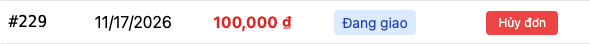
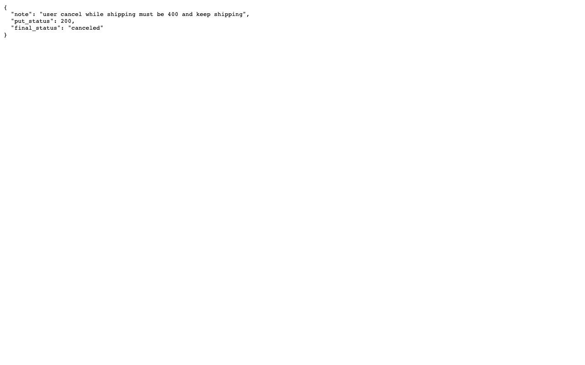

# BUG-FR10-02 — User hủy được đơn đang `shipping` (spec chỉ cho hủy ở `pending`/`confirmed`)

- **Feature:** FR-10 Order state machine · **Pool:** B
- **Test case:** A-FR10-15 (`data/fr10-orders.json`, `tests/fr10-orders.spec.ts`)
- **Severity:** Major · **Browser:** Chromium, Firefox, WebKit (cả 3 đều fail giống hệt)
- **Spec:** README FR-10 — khi đơn đã `shipping`, user không được tự hủy; sơ đồ chỉ có cung hủy từ `pending`/`confirmed`.
- **Precondition:** đơn `#226` của user ở trạng thái `shipping`.
- **Steps:** user `PUT /api/orders/226/cancel` (hoặc bấm `Hủy đơn` ở `/profile` — nút vẫn hiện ở trạng thái `Đang giao`).
- **Expected:** 400, đơn giữ `shipping`.
- **Actual:** 200, đơn chuyển thành `canceled` (xem evidence API).
- **Root cause:** `backend/server.js:329` — chỉ chặn `delivered`/`canceled` (`Lẽ ra phải là pending/confirmed` — chính code đã tự ghi chú); UI phơi nút ở `frontend-web/src/pages/Profile.jsx:200` (`status !== delivered && !== canceled`).
- **Evidence:** row `Đang giao` vẫn có nút `Hủy đơn`:
  
  API sau thao tác (`put_status 200`, `final_status canceled`):
  
- **Playwright report:** `reports/html/fr10-{chromium,firefox,webkit}/` — A-FR10-15 FAIL.
- **GitHub Issue:** <điền sau khi chạy `issues/publish.sh`>
