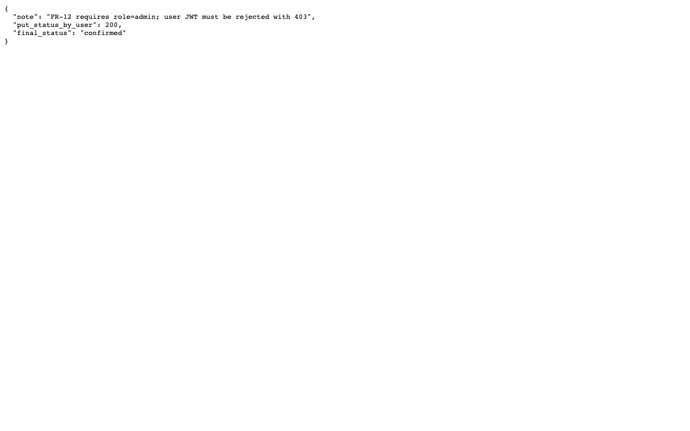

# BUG-FR10-03 (Blocker) — API admin không kiểm tra `role`, user thường đổi được trạng thái đơn bất kỳ

- **Feature:** FR-10 + FR-12 Access control · **Pool:** B/C
- **Test case:** A-FR10-16 (`data/fr10-orders.json`, `tests/fr10-orders.spec.ts`)
- **Severity:** Blocker (missing authorization) · **Browser:** Chromium, Firefox, WebKit (API-only, cả 3 đều fail giống hệt)
- **Spec:** README FR-12 — mọi API `/api/admin/*` phải yêu cầu JWT hợp lệ **và** `role = 'admin'` trong token.
- **Precondition:** user `test@eshop.com` (role `user`) có JWT; đơn `pending` (của mình và của admin).
- **Steps:** gọi `PUT /api/admin/orders/:id/status {"status":"confirmed"}` với JWT user (đơn của mình + đơn của admin); gọi không token.
- **Expected:** JWT user → 403, đơn giữ nguyên; không token → 401.
- **Actual:** JWT user → **200**, đơn đổi trạng thái (cả đơn của user khác); không token → 401 (đúng duy nhất ca này).
- **Root cause:** `backend/server.js:525` (và các endpoint admin khác: `:494`, `:483`, `:510`) chỉ gắn middleware `authenticateToken`, không kiểm tra `req.user.role`; toàn bộ backend không hề đọc `role` (`grep req.user.role` = 0 kết quả).
- **Evidence:** user JWT đổi trạng thái thành công (`put_status_by_user 200`, `final_status confirmed`):
  
- **Playwright report:** `reports/html/fr10-{chromium,firefox,webkit}/` — A-FR10-16 FAIL.
- **GitHub Issue:** https://github.com/SoftwareTesting-Group13/eshop-sut-homework/issues/133
