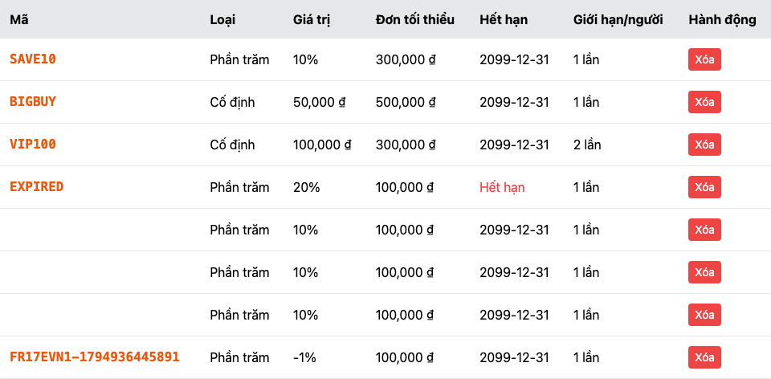

# BUG-FR17-01 — Biên số không được validate: `discount_value` 0/-1/150 và `min_order_amount` -1 đều tạo được

- **Feature:** FR-17 Coupon management · **Pool:** C
- **Test case:** A-FR17-05, A-FR17-06, A-FR17-08, A-FR17-12 (`data/fr17-coupons.json`, `tests/fr17-coupons.spec.ts`)
- **Severity:** Major · **Browser:** Chromium, Firefox, WebKit (cả 3 đều fail giống hệt)
- **Spec:** README FR-17 — `discount_value` dương (percent ≤ 100), `min_order_amount >= 0`.
- **Precondition:** Admin đăng nhập, tab Mã Giảm Giá.
- **Steps:** tạo coupon percent với Giá trị lần lượt `0`, `-1`, `150`; tạo coupon với Đơn tối thiểu `-1` → bấm `Tạo mã`.
- **Expected:** cả 4 đều bị từ chối (non-2xx), không thêm row.
- **Actual:** cả 4 đều 200, row xuất hiện trong bảng (bảng có cả coupon `-1%`).
- **Root cause:** `backend/server.js:457-481` — `INSERT` trực tiếp, không validate giá trị nào; `database.js:29-38` — bảng `coupons` không có `CHECK` nào.
- **Evidence:** bảng admin có row `-1%`:
  
- **Playwright report:** `reports/html/fr17-{chromium,firefox,webkit}/` — A-FR17-05/06/08/12 FAIL.
- **GitHub Issue:** <điền sau khi chạy `issues/publish.sh`>
