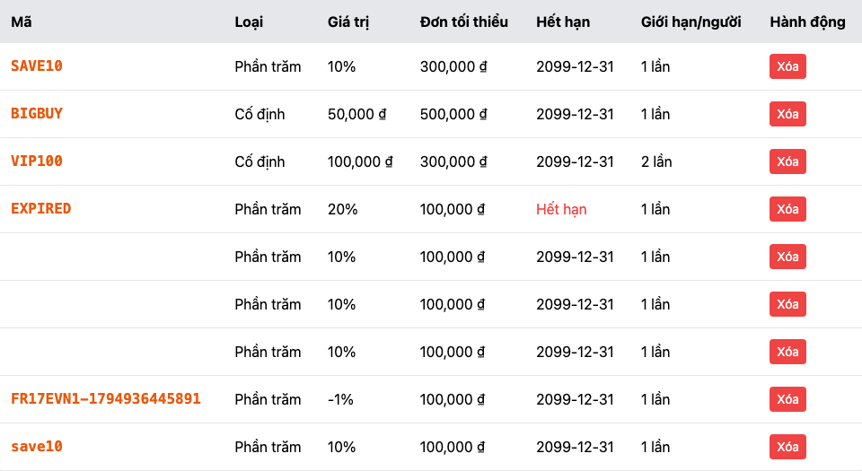
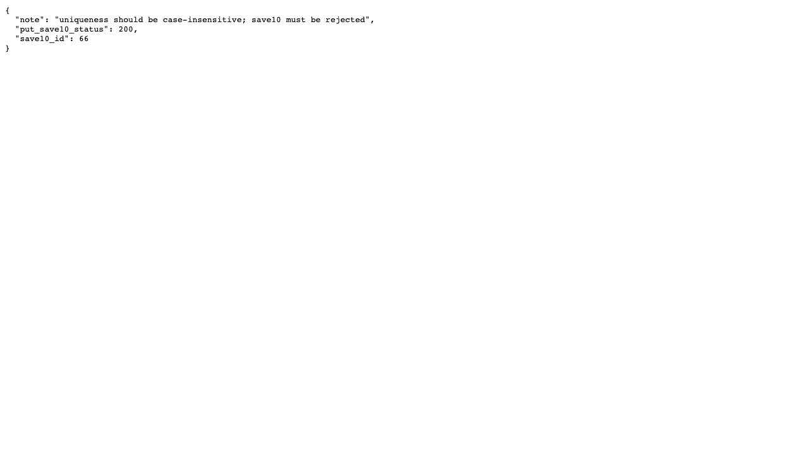

# BUG-FR17-02 — `code` không được validate: chuỗi trắng, trùng khác hoa/thường, thiếu key đều tạo được

- **Feature:** FR-17 Coupon management · **Pool:** C
- **Test case:** A-FR17-04, A-FR17-16, A-FR17-17 (`data/fr17-coupons.json`, `tests/fr17-coupons.spec.ts`)
- **Severity:** Major · **Browser:** Chromium, Firefox, WebKit (cả 3 đều fail giống hệt)
- **Spec:** README FR-17 — `code` bắt buộc và duy nhất (HW02 xác nhận uniqueness không phân biệt hoa/thường).
- **Precondition:** đã có seed `SAVE10`; admin đăng nhập.
- **Steps:** (a) tạo coupon Mã = 3 khoảng trắng; (b) `POST /api/admin/coupons` với `code = "save10"`; (c) `POST` body không có key `code`.
- **Expected:** cả 3 bị từ chối (non-2xx), không thêm row.
- **Actual:** (a) 200 — row mã trắng xuất hiện; (b) 200 — bảng có đồng thời `SAVE10` và `save10` (SQLite `UNIQUE` phân biệt hoa/thường); (c) 200 — row `code = NULL` được chèn (cột cho phép NULL).
- **Root cause:** `backend/server.js:457-481` — không trim/kiểm tra rỗng, không chuẩn hóa hoa/thường, không bắt buộc `code`; `database.js:31` — `code TEXT UNIQUE` (case-sensitive, nullable).
- **Evidence:** `SAVE10` và `save10` cùng tồn tại:
  
  API tạo `save10` trả 200 + id:
  
- **Playwright report:** `reports/html/fr17-{chromium,firefox,webkit}/` — A-FR17-04/16/17 FAIL.
- **GitHub Issue:** <điền sau khi chạy `issues/publish.sh`>
