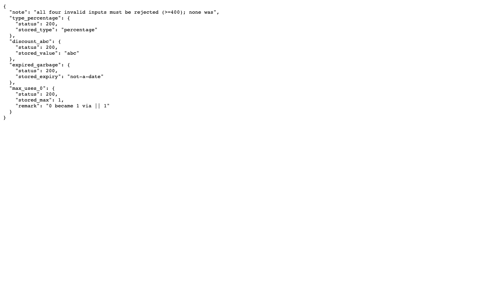

# BUG-FR17-03 — Các trường còn lại không được validate: `type` lạ, `discount` chữ, `expired` rác, `max_uses = 0` thành 1

- **Feature:** FR-17 Coupon management · **Pool:** C
- **Test case:** A-FR17-18 (`data/fr17-coupons.json`, `tests/fr17-coupons.spec.ts`)
- **Severity:** Major · **Browser:** Chromium, Firefox, WebKit (API-only, cả 3 đều fail giống hệt)
- **Spec:** README FR-17 — `type` chỉ `percent`/`fixed`; `discount_value` là số dương; `expired_at` là ngày hợp lệ; `max_uses_per_user >= 1` (0 phải bị từ chối).
- **Precondition:** admin JWT.
- **Steps:** `POST /api/admin/coupons` với (a) `type = "percentage"`; (b) `discount_value = "abc"`; (c) `expired_at = "not-a-date"`; (d) `max_uses_per_user = 0`.
- **Expected:** cả 4 trả non-2xx, không thêm row.
- **Actual:** cả 4 trả 200 và chèn row: `type` lạ và chuỗi rác được lưu nguyên; riêng (d) `0` bị biến thành `1` do `max_uses_per_user || 1` (`server.js:474`) rồi chèn thành công.
- **Root cause:** `backend/server.js:457-481` — không validate; `server.js:474` — `|| 1` nuốt lỗi input `0` thay vì từ chối.
- **Evidence:** cả 4 đều 200 và giá trị rác được lưu:
  
- **Playwright report:** `reports/html/fr17-{chromium,firefox,webkit}/` — A-FR17-18 FAIL (4/4 soft asserts).
- **GitHub Issue:** https://github.com/SoftwareTesting-Group13/eshop-sut-homework/issues/136
